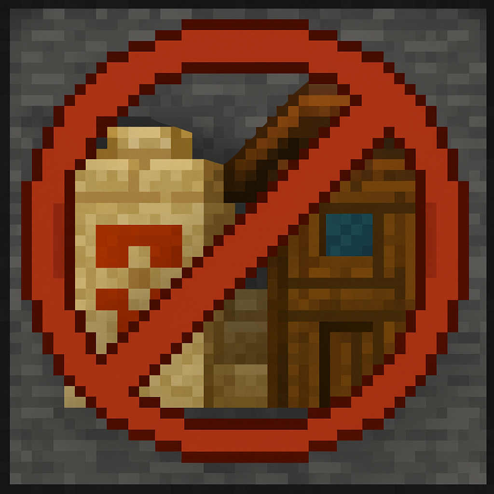

# NoStructureOverlap 3.0.0



NeoForge mod for **Minecraft 1.21.1** that stops **different** structures from generating inside each other.

It compares vanilla `StructureStart` bounding boxes after piece layout (including jigsaw) and before blocks are placed. Same structure id may still overlap; pieces inside one start are never treated as conflicts.

**Release:** [v3.0.0](https://github.com/Ankinkun/NoStructureOverlap/releases/tag/v3.0.0)

## How it works

1. Vanilla chooses a candidate chunk and runs `Structure.generate`
2. Pieces are built → `StructureStart.getBoundingBox()` is available
3. If that box intersects another tracked start with a **different** registry id, the mod returns `StructureStart.INVALID_START`
4. Vanilla never stores or places the blocked start

Tracking is dimension-scoped and in-memory (`StructureBoundingBoxTracker`).

## Config

`config/nostructureoverlap-common.toml`

| Option | Default | Description |
|--------|---------|-------------|
| `enableOverlapPrevention` | `true` | Master switch |
| `use3DOverlapDetection` | `true` | Full 3D AABB; `false` = X/Z only |
| `logBlockedStructures` | `true` | Log when a start is blocked |
| `structureWhitelist` | `[]` | If set, only these ids are checked |
| `structureBlacklist` | `[]` | These ids skip checks |
| `structureSpecificEnabled` | `[]` | Overrides like `["minecraft:mineshaft=false"]` |

Use real registry ids (`minecraft:village_plains`), not class names.

## Commands

| Command | Description |
|---------|-------------|
| `/nostructureoverlap status` | Enabled state, tracked count, 3D/2D mode |
| `/nostructureoverlap info` | Full status summary |
| `/nostructureoverlap structures` | Active whitelist / blacklist / overrides |

## Install

1. NeoForge for Minecraft 1.21.1
2. Put `nostructureoverlap-3.0.0.jar` in `mods/`
3. Launch client or dedicated server

## Compatibility

- Minecraft **1.21.1**
- NeoForge **21.1.208** (project pin; dependency range `[21,)`)
- Vanilla and modded structures that use `Structure.generate` / `StructureStart`
- Does not cover custom worldgen that places blocks without structure starts

## Build

```powershell
.\gradlew.bat build
```

Output: `build/libs/nostructureoverlap-3.0.0.jar`

## License

See [LICENSE](LICENSE).
